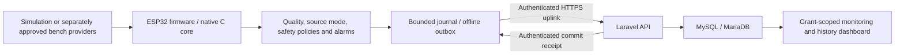

# Integrated Vessel Monitoring & Diagnostic Gateway

An ESP32-oriented monitoring and diagnostic prototype that carries simulated sensor data through embedded validation, alarm/event handling, authenticated Laravel ingestion, MySQL storage, and a grant-scoped dashboard.

**Local software closure:** `LOCAL_SOFTWARE_SCOPE_COMPLETE_WITH_EXTERNAL_BLOCKERS` ([38-requirement decision](docs/testing/final-local-software-audit-20261027.md)). The overall system remains **PARTIAL / NOT_APPROVED**. Physical ESP32 behavior, power-loss durability, deployed TLS, hosted CI, calibration, and operational acceptance are not established by local software evidence. This is not marine safety equipment or a production-ready system.

## Problem and engineering approach

A monitoring gateway must distinguish a measured zero from missing data, keep local diagnostics running during an uplink outage, and avoid losing an alarm fact after an ambiguous network response. This project explores those boundaries with explicit quality/source metadata, bounded offline queues, authenticated commit receipts, and requirement-linked tests.

The four-engine demonstration is synthetic. No starter, ignition, steering, radar, radio, or mission-system control is implemented. OEM protocols and physical interfaces remain subject to separate verification; no operational vessel installation or organizational affiliation is claimed.

## Architecture



The diagram describes the software design. Native tests exercise the core on a host computer; they do not execute a physical ESP32. See the [architecture and ICD](docs/architecture/architecture-and-icd.md) for the full interface boundaries.

| Component | Implementation and responsibilities |
|---|---|
| Firmware | C99 core and ESP-IDF adapters; providers, quality validation, safety policies, four-engine simulation, NMEA-style navigation, alarm lifecycle, bounded event storage and HTTPS transport |
| Backend | PHP 8.2 / Laravel 12; bounded JSON admission, device authentication, deduplication, event history, exact commit receipts, session and grant checks |
| Database | MySQL schema through Laravel migrations only; local integration evidence uses an isolated MariaDB 10.4.32 test instance |
| Dashboard | Laravel Blade views and JavaScript; per-device access, eight monitoring sections, source/quality presentation and receipt display expiry |
| Verification | Python, native GCC/Clang fixtures, PHPUnit, Node and browser probes; living traceability and scoped evidence |

Every sample identifies `simulation`, `bench_test`, or the reserved `physical` source mode. A `physical` label in a negative/synthetic fixture is not evidence of physical acquisition. Missing, invalid and stale measurements must not silently become valid zeros. Receiving an HTTP response alone must not clear an alarm or retire an unconfirmed event.

## Try the software without hardware

The native demonstration requires Python 3, Git, and GCC on PATH. It needs **no ESP32, Laravel installation, network connection, or database**. Clang can run the core self-test; the wire fixture defaults to GCC and also supports `VG_HOST_CC`.

From the repository root:

```bash
python -B scripts/test_firmware_core_host.py --repeat 2
python -B scripts/continuous_simulation_wire_bridge.py --output demo-frames.jsonl
```

Use a new output filename; the wire command refuses an existing artifact. It compiles the actual C99 fixture and writes 24 deterministic recovered frames, each containing 48 channels, `source_mode=simulation`, sequence/uptime, and explicit quality/value fields. This is a finite command-line demonstration, not a live physical sensor stream or a running dashboard.

Read the frames in a text editor. Invalid/missing/unknown channels use JSON `null`; zero is a distinct value. The [local demo guide](docs/portfolio/local-demo.md) explains expected output, toolchain setup, and the separate guarded backend/dashboard workflow.

For traceability without a C compiler:

```bash
python -B scripts/check_living_traceability.py
```

A missing compiler or runtime is **BLOCKED/NOT_RUN**, not PASS. Do not point integration scripts at a normal application database. Backend integration requires a verified isolated MySQL/MariaDB test database and the existing fail-closed protocol in [MySQL integration](docs/testing/mysql-integration-gate.md). No credentials or local environment files are supplied for publication.

## Evidence and current limits

These are recorded executions, not claims that every suite was rerun for this README. Source-bound evidence identifies exact environments and limitations.

| Recorded result | Evidence and scope |
|---|---|
| 226/226 native core cases, repeated boot entry | [Final audit gate matrix](evidence/test-results/final-local-audit-gate-matrix-20261027.csv); host behavior only |
| 388 PHP/Laravel tests, isolated MariaDB | [Restored MySQL run](evidence/test-results/formal-resilience-mysql-restored-run1-20261027.txt); PHP 8.2.35, no production database |
| 248 loopback TLS checks and Chrome component behavior | [Local TLS run](evidence/test-results/formal-resilience-normal-restored-run1-20261027.txt), [browser evidence](evidence/test-results/formal-resilience-browser-approved-runtime-20261027.txt); not deployed/ESP32 TLS |
| Actual 60,047 ms host outage and valid-data recovery | [Resilience case review](evidence/test-results/formal-resilience-case-review-20261027.md); no hardware timing or NVS durability claim |
| 15 SIM cases and 18 SUP cases with scoped PASS records | [Living traceability](docs/testing/living-traceability-guide.md); SUP-018 hosted CI remains PLANNED |
| 38 requirements reviewed | [Final decision](docs/testing/final-local-software-audit-20261027.md): 32 local implementations complete but not formally verified; 6 external prerequisites |

The living implementation register remains 22 `IMPLEMENTED_UNVERIFIED` / 16 `PARTIAL`; no requirement is promoted to `VERIFIED`. Additional full-composition GCC analysis is tool-blocked and ASan/UBSan coverage remains NOT_RUN. Hardware, RTOS behavior, physical NVS/power loss, deployed TLS, hosted CI and final acceptance require separate evidence.

## Development history and design decisions

Development progressed from a clean planning baseline through firmware/provider/safety/navigation gates, Laravel ingestion, secure monitoring, continuous simulation, alarm metadata, offline replay and receipt recovery. The history includes actual bug fixes and failed attempts; a commit count is not a correctness or contribution-graph score.

Examples of design work recorded in the original local history:

| Original commit | Work represented |
|---|---|
| `dfec54b` | Engineering planning baseline, 2026-10-10 |
| `4476c3b` | Pre-backend firmware edge-case repairs and verifier hardening |
| `fa72f40` | Laravel backend foundation |
| `bd34639` | Grant-scoped monitoring and secure sessions |
| `5048525` | Continuous full-domain simulation |
| `70963d4` | End-to-end alarm transition metadata |
| `5727969` | Authenticated receipts and confirmed event retirement |
| `bf29a8b` | Receipt display expiry and browser integration fix |
| `4892054` | Failed-publication retry ordering fix |
| `98455c3` | Actual host outage/multifault/valid-data recovery evidence |
| `be6bad7` / `cf2044a` | Final local software audit and handoff closure |

A sanitized publication candidate maps original hashes to new hashes while retaining author, author/committer dates, messages and parent topology. Original evidence stays in the local repository. Public candidate copies redact machine-profile prefixes and omit environment files; edited evidence copies are labelled as sanitized, not byte-identical originals. Do not describe rewritten hashes as the original Git history. See the [publication review report](docs/portfolio/publication-review-20261027.md) for the three options, mapping, security gates and approval boundary.

## Repository map

- `firmware/`: native core, self-tests, ESP-IDF adapters and simulation configuration.
- `backend/laravel/`: API, migrations, dashboard, security boundaries and PHP tests.
- `scripts/`: native fixtures, integration gates, browser probes and audit tooling.
- `requirements/`: the unchanged 38 requirements and baseline traceability matrix.
- `docs/`: architecture, ICD, ADRs, roadmap, verification and portfolio guides.
- `evidence/`: dated execution records with explicit scopes and limitations.
- `.github/workflows/`: workflow source; presence does not prove hosted execution.

Start with [requirements](requirements/system-requirements.md), [architecture](docs/architecture/architecture-and-icd.md), [roadmap](docs/github-repository-plan.md), [Codex handoff](docs/handoff/CODEX_RESUME.md), and [ChatGPT context](docs/handoff/CHATGPT_CONTEXT.md).

## AI-assisted development and attribution

Codex/ChatGPT assisted with implementation, debugging, test tooling, security review and documentation. The repository preserves source changes and executed evidence so reviewers can inspect the work instead of relying on generated descriptions. AI assistance and passing local tests do not replace independent engineering review, hardware validation or formal approval. No fabricated screenshots, backdated activity or invented hardware experience is presented.

## License and publication

All rights reserved. No general open-source permission to reuse, modify or redistribute these contents is granted. GitHub platform features remain subject to applicable law and GitHub's terms. No license change is implied by portfolio preparation.

Publication is a separate approval step. Do not publish the original object database, raw workspace ZIPs, dotenv files, dependency caches, protected local files or private evidence. This preparation does not push, force-push, merge remotely, replace an existing public history, or change a GitHub default branch.
